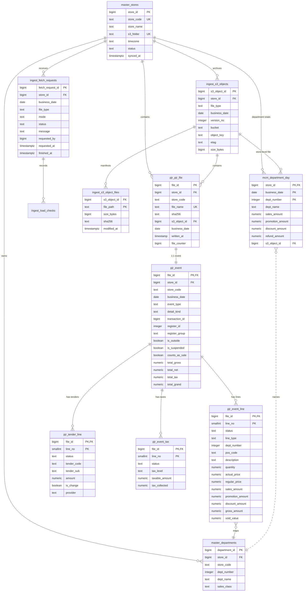

# gilbarco_db: Database Design & Schema Specification

Authoritative database specification for `gilbarco-ingestion-service`.  
Database: `gilbarco_db` (Test: `gilbarco_db_test`)  
RDBMS: PostgreSQL 17  
Collation: UTF-8  
Timezone: UTC  

---

## 1. Architectural Tree Hierarchy & Motive

Both `verifone-ingestion-service` and `gilbarco-ingestion-service` share the **exact same fundamental motive**:
1. **Autonomous, Offline-Resilient Ingestion**: Ingest POS day packages from S3 into a local dedicated database with real foreign keys to an autonomous `master.stores` replica (synced on-demand from `auth_db`).
2. **Cryptographic & Physical Auditability**: Every zip downloaded from S3 is tracked in `ingest.s3_objects` and its contents verified against `manifest.json` in `ingest.s3_object_files`.
3. **Format-Isolated Database Schemas**: Shared metadata lives in `master`, ingestion audit lives in `ingest`, and POS file formats live in their own dedicated, isolated schemas to prevent table clutter and allow independent lifecycles.

```
                            gilbarco_db (Database)
                                       │
        ┌──────────────────────────────┴──────────────────────────────┐
        │                                                             │
 ┌──────┴──────┐                                               ┌──────┴──────┐
 │   master    │  (Shared store replica & POS master codes)    │   ingest    │  (S3 zip audit & fetch status)
 │   schema    │  stores, departments, items, fuel_grades     │   schema    │  file_type='PJR'|'MCM'|'FGM'|'MSM'
 └──────┬──────┘                                               └──────┬──────┘
        │                                                             │
        │   ┌──────────────────────────┼──────────────────────────┐   │
        │   │                          │                          │   │
        ▼   ▼                          ▼   ▼                      ▼   ▼
 ┌───────────────┐              ┌───────────────┐          ┌───────────────┐
 │  pjr schema   │              │  mcm schema   │          │  fgm schema   │  (also msm, tlm, ism, fpm, tpm)
 │ (Active, V2)  │              │ (Active, V6)  │          │   (Future)    │
 ├───────────────┤              ├───────────────┤          ├───────────────┤
 │• pjr_file     │              │• department_  │          │• fgm_files    │
 │• event        │              │  day          │          │• fuel_meters  │
 │• event_line   │              │ (store level, │          │• price_tiers  │
 │• tender_line  │              │  ~22 rows/day)│          │• ...          │
 │• event_tax    │              │               │          │               │
 └───────────────┘              └───────────────┘          └───────────────┘
```

`report` (views only) reads across the format schemas: the PJR reports, and since V6 the MCM-vs-PJR proof
(`rpt_mcm_department_check`, `rpt_mcm_day_check`, section 7).

### Architectural Symmetry: Verifone vs. Gilbarco

| Architectural Layer | Verifone (`verifone_db`) | Gilbarco (`gilbarco_db`) |
|---|---|---|
| **Service & Port** | `verifone-ingestion-service` (Port **8092**) | `gilbarco-ingestion-service` (Port **8093**) |
| **Store Replica** | `master.stores` (`pos_vendor = 'VERIFONE'`) | `master.stores` (`pos_vendor = 'GILBARCO'`) |
| **Ingestion Tracking** | `ingest.s3_objects`, `ingest.s3_object_files`, `ingest.fetch_requests`, `ingest.load_checks` | `ingest.s3_objects`, `ingest.s3_object_files`, `ingest.fetch_requests`, `ingest.load_checks` |
| **Active File Format** | `cpj` schema (Closed Period Journal, 1 large XML per day) | `pjr` schema (POS Journal, ~700–1,050 XML files per day); `mcm` schema (store-level department totals, 1 of the 2 MCM files per day) |
| **Future File Formats** | Planned: `msm`, `fgm` | Planned: `msm`, `fgm`, `tlm`, `ism`, `tpm`, `fpm` |
| **Reporting Proof** | Reconciled against Verifone SUM/MCM/LYT | Reconciled against Gilbarco StoreClose PDFs; every day against MCM (`report.rpt_mcm_day_check`) |


---

## 2. Mermaid Entity-Relationship Diagram



---

## 3. Schema DDL: `master`

```sql
CREATE SCHEMA master;

-- Replicated from auth_db.core.stores WHERE pos_vendor = 'GILBARCO'
CREATE TABLE master.stores (
    store_id         BIGINT       PRIMARY KEY,
    store_code       TEXT         NOT NULL,
    store_name       TEXT         NOT NULL,
    s3_folder        TEXT         NOT NULL,
    timezone         TEXT         NOT NULL,
    status           TEXT         NOT NULL,
    synced_at        TIMESTAMPTZ  NOT NULL,
    copied_at        TIMESTAMPTZ  NOT NULL DEFAULT now(),
    CONSTRAINT uq_master_stores_code   UNIQUE (store_code),
    CONSTRAINT uq_master_stores_s3     UNIQUE (s3_folder),
    CONSTRAINT ck_master_stores_id     CHECK (store_id > 0),
    CONSTRAINT ck_master_stores_code   CHECK (store_code ~ '^[A-Za-z0-9][A-Za-z0-9_-]*$'),
    CONSTRAINT ck_master_stores_status CHECK (status IN ('ACTIVE', 'INACTIVE'))
);

-- Store departments discovered from MerchandiseCodeLine in PJR files
CREATE TABLE master.departments (
    department_id    BIGINT       GENERATED ALWAYS AS IDENTITY PRIMARY KEY,
    store_id         BIGINT       NOT NULL REFERENCES master.stores (store_id) ON DELETE RESTRICT,
    store_code       TEXT         NOT NULL,
    dept_number      INTEGER      NOT NULL,
    dept_name        TEXT,
    sales_class      TEXT         NOT NULL DEFAULT 'merchandise',
    created_at       TIMESTAMPTZ  NOT NULL DEFAULT now(),
    updated_at       TIMESTAMPTZ  NOT NULL DEFAULT now(),
    CONSTRAINT uq_master_departments UNIQUE (store_id, dept_number),
    CONSTRAINT ck_master_departments_class CHECK (sales_class IN ('merchandise', 'lottery_sale', 'lottery_payout', 'fuel'))
);
CREATE INDEX ix_master_departments_store ON master.departments (store_code, dept_number);
```

**Admin-set departments (V5).** The loader names a department only from a department ring; scanned lines carry
just the number. A department that is only ever scanned (scratch-off tickets) stays unnamed and falls into
merchandise (Wolf, 2026-10-14..15: dept 5, $2,527.00 of NY scratch-off games). A platform admin fixes that from
the ingestion console (`PUT …/departments/{deptNumber}`):

```sql
ALTER TABLE master.departments
    ADD COLUMN pos_name      TEXT,         -- the name the POS files last gave; the loader always keeps it current
    ADD COLUMN admin_set_by  BIGINT,       -- set: the admin owns dept_name and sales_class
    ADD COLUMN admin_set_at  TIMESTAMPTZ,
    ADD CONSTRAINT ck_master_departments_admin CHECK ((admin_set_by IS NULL) = (admin_set_at IS NULL));

CREATE TABLE master.department_changes (   -- every admin change, newest read first
    change_id BIGINT GENERATED ALWAYS AS IDENTITY PRIMARY KEY, store_id BIGINT NOT NULL REFERENCES master.stores,
    dept_number INTEGER NOT NULL, action TEXT NOT NULL CHECK (action IN ('SET', 'RESET')),
    old_name TEXT, old_sales_class TEXT NOT NULL, new_name TEXT, new_sales_class TEXT NOT NULL, note TEXT,
    changed_by BIGINT NOT NULL, changed_at TIMESTAMPTZ NOT NULL DEFAULT now());
```

`dept_name` / `sales_class` keep their meaning (what every report uses), so no report view changed. While
`admin_set_at` is NULL they follow `pos_name` as before; once set, the loader updates only `pos_name`. RESET puts
`dept_name = pos_name` and the class from that name back. The views read the table at query time, so a change shows
on every report at once, past days included.

---

## 4. Schema DDL: `ingest`

```sql
CREATE SCHEMA ingest;

-- Downloaded zip metadata from S3
CREATE TABLE ingest.s3_objects (
    s3_object_id         BIGINT       GENERATED ALWAYS AS IDENTITY PRIMARY KEY,
    store_id             BIGINT       NOT NULL REFERENCES master.stores (store_id) ON DELETE RESTRICT,
    file_type            TEXT         NOT NULL,
    business_date        DATE         NOT NULL,
    version_no           INTEGER      NOT NULL,
    bucket               TEXT         NOT NULL,
    object_key           TEXT         NOT NULL,
    etag                 TEXT         NOT NULL,
    size_bytes           BIGINT       NOT NULL,
    last_modified        TIMESTAMPTZ  NOT NULL,
    manifest_created_at  TIMESTAMPTZ  NOT NULL,
    mirror_version       TEXT         NOT NULL,
    downloaded_at        TIMESTAMPTZ  NOT NULL DEFAULT now(),
    CONSTRAINT uq_s3_objects_object   UNIQUE (bucket, object_key, etag),
    CONSTRAINT uq_s3_objects_day      UNIQUE (s3_object_id, store_id, business_date),
    CONSTRAINT ck_s3_objects_type     CHECK (file_type IN ('PJR', 'MCM', 'MSM', 'FGM', 'TLM', 'ISM', 'FPM', 'TPM')),
    CONSTRAINT ck_s3_objects_version  CHECK (version_no > 0),
    CONSTRAINT ck_s3_objects_size     CHECK (size_bytes > 0)
);
CREATE INDEX ix_s3_objects_day ON ingest.s3_objects (store_id, file_type, business_date, version_no);

-- Individual POS XML files packed inside the zip (from manifest.json)
CREATE TABLE ingest.s3_object_files (
    s3_object_id     BIGINT       NOT NULL REFERENCES ingest.s3_objects (s3_object_id) ON DELETE CASCADE,
    file_path        TEXT         NOT NULL,
    size_bytes       BIGINT       NOT NULL,
    sha256           CHAR(64)     NOT NULL,
    modified_at      TIMESTAMPTZ  NOT NULL,
    PRIMARY KEY (s3_object_id, file_path),
    CONSTRAINT ck_s3_object_files_size CHECK (size_bytes >= 0)
);

-- Async fetch requests tracking
CREATE TABLE ingest.fetch_requests (
    fetch_request_id BIGINT       GENERATED ALWAYS AS IDENTITY PRIMARY KEY,
    store_id         BIGINT       NOT NULL REFERENCES master.stores (store_id) ON DELETE RESTRICT,
    business_date    DATE         NOT NULL,
    file_type        TEXT         NOT NULL DEFAULT 'PJR',
    mode             TEXT         NOT NULL,
    status           TEXT         NOT NULL,
    message          TEXT,
    s3_object_id     BIGINT       REFERENCES ingest.s3_objects (s3_object_id) ON DELETE SET NULL,
    requested_by     BIGINT       NOT NULL,
    requested_at     TIMESTAMPTZ  NOT NULL DEFAULT now(),
    finished_at      TIMESTAMPTZ,
    CONSTRAINT ck_fetch_requests_type   CHECK (file_type IN ('PJR', 'MCM', 'MSM', 'FGM', 'TLM', 'ISM', 'FPM', 'TPM')),
    CONSTRAINT ck_fetch_requests_mode   CHECK (mode IN ('REFUSE', 'REPLACE')),
    CONSTRAINT ck_fetch_requests_status CHECK (status IN ('CLAIMED', 'RUNNING', 'LOADED', 'REFUSED', 'NOT_FOUND', 'FAILED'))
);
CREATE INDEX ix_fetch_requests_store_day ON ingest.fetch_requests (store_id, file_type, business_date);
CREATE INDEX ix_fetch_requests_running   ON ingest.fetch_requests (status) WHERE status = 'RUNNING';

-- Integrity verification checks performed post-load
CREATE TABLE ingest.load_checks (
    check_id         BIGINT        GENERATED ALWAYS AS IDENTITY PRIMARY KEY,
    fetch_request_id BIGINT        NOT NULL REFERENCES ingest.fetch_requests (fetch_request_id) ON DELETE CASCADE,
    check_name       TEXT          NOT NULL,
    expected         NUMERIC(14,4),
    actual           NUMERIC(14,4),
    passed           BOOLEAN       NOT NULL,
    hard             BOOLEAN       NOT NULL,
    detail           TEXT,
    checked_at       TIMESTAMPTZ   NOT NULL DEFAULT now()
);
CREATE INDEX ix_load_checks_fetch ON ingest.load_checks (fetch_request_id);
```

---

## 5. Schema DDL: `pjr` (POS Journal Transactions)

```sql
CREATE SCHEMA pjr;

-- Exactly one row per loaded Gilbarco PJR XML file
CREATE TABLE pjr.pjr_file (
    file_id               BIGSERIAL     PRIMARY KEY,
    store_id              BIGINT        NOT NULL REFERENCES master.stores (store_id) ON DELETE RESTRICT,
    store_code            TEXT          NOT NULL,
    s3_object_id          BIGINT        REFERENCES ingest.s3_objects (s3_object_id) ON DELETE CASCADE,
    file_name             TEXT          NOT NULL,
    sha256                CHAR(64)      NOT NULL,
    size_bytes            INTEGER       NOT NULL,
    written_at            TIMESTAMP,
    file_counter          BIGINT,
    store_location        TEXT,
    vendor_version        TEXT,
    business_date         DATE          NOT NULL,
    shift_begin           TIMESTAMP,
    loaded_at             TIMESTAMPTZ   NOT NULL DEFAULT now(),
    CONSTRAINT uq_pjr_file UNIQUE (store_id, file_name)
);
CREATE INDEX ix_pjr_file_day ON pjr.pjr_file (store_id, business_date);

-- Exactly one event per PJR file
CREATE TABLE pjr.event (
    file_id               BIGINT        PRIMARY KEY REFERENCES pjr.pjr_file (file_id) ON DELETE CASCADE,
    store_id              BIGINT        NOT NULL REFERENCES master.stores (store_id) ON DELETE RESTRICT,
    store_code            TEXT          NOT NULL,
    business_date         DATE          NOT NULL,
    event_type            TEXT          NOT NULL,
    detail_kind           TEXT          NOT NULL,
    transaction_id        BIGINT,
    register_id           INTEGER,
    register_group        TEXT          GENERATED ALWAYS AS (
                               CASE WHEN register_id BETWEEN 10001 AND 10999 THEN 'pump'
                                    WHEN register_id IS NOT NULL THEN 'inside' END) STORED,
    cashier_id            TEXT,
    till_id               TEXT,
    started_at            TIMESTAMP,
    ended_at              TIMESTAMP,
    receipt_at            TIMESTAMP,
    is_outside            BOOLEAN       NOT NULL DEFAULT false,
    is_suspended          BOOLEAN       NOT NULL DEFAULT false,
    is_training           BOOLEAN       NOT NULL DEFAULT false,
    is_offline            BOOLEAN       NOT NULL DEFAULT false,
    counts_as_sale        BOOLEAN       GENERATED ALWAYS AS (
                               event_type IN ('SaleEvent', 'RefundEvent') AND NOT is_suspended) STORED,
    linked_register_id    INTEGER,
    linked_transaction_id BIGINT,
    link_reason           TEXT,
    loyalty_program       TEXT,
    total_gross           NUMERIC(12,2),
    total_net             NUMERIC(12,2),
    total_tax             NUMERIC(12,2),
    total_grand           NUMERIC(12,2),
    grand_direction       TEXT,
    detail_amount         NUMERIC(12,2),
    payee                 TEXT,
    alert_code            TEXT,
    reason                TEXT
);
CREATE INDEX ix_pjr_event_day ON pjr.event (store_id, business_date, detail_kind);
CREATE INDEX ix_pjr_event_txn ON pjr.event (store_id, register_id, transaction_id);

-- Transaction lines (Item, Department Ring, Fuel, Prepay)
CREATE TABLE pjr.event_line (
    file_id               BIGINT        NOT NULL REFERENCES pjr.event (file_id) ON DELETE CASCADE,
    line_no               SMALLINT      NOT NULL,
    store_id              BIGINT        NOT NULL REFERENCES master.stores (store_id) ON DELETE RESTRICT,
    store_code            TEXT          NOT NULL,
    business_date         DATE          NOT NULL,
    status                TEXT          NOT NULL,
    line_type             TEXT          NOT NULL,
    dept_number           INTEGER,
    pos_code              TEXT,
    pos_code_format       TEXT,
    pos_code_modifier     TEXT,
    description           TEXT,
    entry_method          TEXT,
    quantity              NUMERIC(12,3),
    selling_units         NUMERIC(12,3),
    actual_price          NUMERIC(12,3),
    regular_price         NUMERIC(12,3),
    sales_amount          NUMERIC(12,2) NOT NULL DEFAULT 0,
    promotion_amount      NUMERIC(12,2) NOT NULL DEFAULT 0,
    discount_amount       NUMERIC(12,2) NOT NULL DEFAULT 0,
    promotion_reasons     TEXT,
    gross_amount          NUMERIC(12,2) GENERATED ALWAYS AS (sales_amount - promotion_amount - discount_amount) STORED,
    void_value            NUMERIC(12,2) GENERATED ALWAYS AS (
                               CASE WHEN status = 'cancel' AND line_type IN ('ItemLine', 'FuelLine')
                                    THEN round(regular_price * quantity, 2) END) STORED,
    tax_level             TEXT,
    fuel_grade_id         TEXT,
    fuel_position         SMALLINT,
    price_tier            TEXT,
    service_level         TEXT,
    PRIMARY KEY (file_id, line_no)
);
CREATE INDEX ix_pjr_line_day  ON pjr.event_line (store_id, business_date, line_type);
CREATE INDEX ix_pjr_line_dept ON pjr.event_line (store_id, dept_number, business_date);
CREATE INDEX ix_pjr_line_code ON pjr.event_line (pos_code) WHERE pos_code IS NOT NULL;

-- Tender lines (Cash, Cards, House Account, Outside Credit/Debit)
CREATE TABLE pjr.tender_line (
    file_id               BIGINT        NOT NULL REFERENCES pjr.event (file_id) ON DELETE CASCADE,
    line_no               SMALLINT      NOT NULL,
    status                TEXT          NOT NULL,
    tender_code           TEXT          NOT NULL,
    tender_sub            TEXT,
    amount                NUMERIC(12,2) NOT NULL,
    is_change             BOOLEAN       NOT NULL DEFAULT false,
    provider              TEXT,
    authorized_amount     NUMERIC(12,2),
    PRIMARY KEY (file_id, line_no)
);

-- Transaction tax lines
CREATE TABLE pjr.event_tax (
    file_id               BIGINT        NOT NULL REFERENCES pjr.event (file_id) ON DELETE CASCADE,
    line_no               SMALLINT      NOT NULL,
    status                TEXT          NOT NULL,
    tax_level             TEXT          NOT NULL,
    taxable_amount        NUMERIC(12,2),
    tax_collected         NUMERIC(12,2),
    taxable_refunded      NUMERIC(12,2),
    tax_refunded          NUMERIC(12,2),
    tax_exempt            NUMERIC(12,2),
    tax_forgiven_sales    NUMERIC(12,2),
    PRIMARY KEY (file_id, line_no)
);

-- Unparseable or rejected files
CREATE TABLE pjr.load_failure (
    failure_id            BIGSERIAL     PRIMARY KEY,
    store_id              BIGINT        REFERENCES master.stores (store_id) ON DELETE CASCADE,
    store_code            TEXT,
    file_name             TEXT          NOT NULL,
    sha256                CHAR(64),
    error                 TEXT          NOT NULL,
    failed_at             TIMESTAMPTZ   NOT NULL DEFAULT now()
);
```

---

## 6. Schema DDL: `report` (Reporting Views)

```sql
CREATE SCHEMA report;

-- Every sold line on completed sale/refund transactions
CREATE VIEW report.v_sold_line AS
SELECT e.store_id,
       e.store_code,
       e.business_date,
       e.file_id,
       e.transaction_id                          AS ticket_number,
       e.event_type,
       e.register_id                             AS register,
       e.register_group,
       e.cashier_id                              AS cashier,
       e.started_at,
       e.ended_at                                AS sold_at,
       l.line_no,
       l.line_type,
       CASE l.line_type WHEN 'ItemLine' THEN 'item' WHEN 'MerchandiseCodeLine' THEN 'department' ELSE 'fuel' END AS line_kind,
       l.dept_number,
       CASE WHEN l.line_type = 'FuelLine' THEN 'Fuel' ELSE d.dept_name END AS dept_name,
       CASE WHEN l.line_type = 'FuelLine' THEN 'fuel' ELSE coalesce(d.sales_class, 'merchandise') END AS sales_class,
       l.pos_code                                AS upc,
       l.pos_code_format,
       l.description,
       l.entry_method,
       l.quantity,
       l.actual_price                            AS unit_price,
       l.regular_price,
       l.gross_amount,
       l.gross_amount - l.sales_amount           AS promo_amount,
       l.sales_amount                            AS net_amount,
       l.promotion_reasons,
       l.fuel_grade_id,
       CASE WHEN l.line_type = 'FuelLine' THEN l.description END AS fuel_grade,
       l.price_tier                              AS fuel_price_level,
       CASE WHEN l.line_type = 'FuelLine' THEN l.quantity END    AS fuel_volume,
       l.fuel_position
FROM pjr.event e
JOIN pjr.event_line l USING (file_id)
LEFT JOIN master.departments d ON d.store_id = e.store_id AND d.dept_number = l.dept_number
WHERE e.counts_as_sale
  AND l.status = 'normal'
  AND l.line_type IN ('ItemLine', 'MerchandiseCodeLine', 'FuelLine');

-- Daily Day Summary matching StoreClose PDF exactly
CREATE VIEW report.rpt_day_summary AS
WITH
sales AS (
    SELECT store_id, store_code, business_date,
           sum(CASE WHEN sales_class = 'merchandise' THEN gross_amount ELSE 0 END) AS merch_gross,
           sum(CASE WHEN sales_class = 'merchandise' THEN net_amount   ELSE 0 END) AS merch_net,
           sum(CASE WHEN sales_class = 'lottery_sale' THEN gross_amount ELSE 0 END) AS lotto_sales,
           sum(CASE WHEN sales_class = 'lottery_payout' THEN gross_amount ELSE 0 END) AS lotto_payouts,
           sum(CASE WHEN sales_class = 'fuel' THEN gross_amount ELSE 0 END) AS fuel_gross,
           sum(CASE WHEN sales_class = 'fuel' THEN net_amount   ELSE 0 END) AS fuel_net
    FROM report.v_sold_line
    GROUP BY store_id, store_code, business_date
),
taxes AS (
    SELECT e.store_id, e.store_code, e.business_date,
           sum(t.tax_collected) AS tax_collected
    FROM pjr.event e
    JOIN pjr.event_tax t USING (file_id)
    WHERE e.counts_as_sale AND t.status = 'normal'
    GROUP BY e.store_id, e.store_code, e.business_date
),
tenders AS (
    SELECT e.store_id, e.store_code, e.business_date,
           sum(tl.amount) AS tenders_total
    FROM pjr.event e
    JOIN pjr.tender_line tl USING (file_id)
    WHERE e.counts_as_sale AND tl.status = 'normal'
    GROUP BY e.store_id, e.store_code, e.business_date
)
SELECT s.store_id,
       s.store_code,
       s.business_date,
       coalesce(s.merch_gross, 0) AS merch_gross,
       coalesce(s.merch_net, 0)   AS merch_net,
       coalesce(s.lotto_sales, 0) AS lotto_sales,
       coalesce(s.lotto_payouts, 0) AS lotto_payouts,
       coalesce(s.fuel_gross, 0)  AS fuel_gross,
       coalesce(s.fuel_net, 0)    AS fuel_net,
       coalesce(t.tax_collected, 0) AS tax_collected,
       coalesce(s.merch_net, 0) + coalesce(s.lotto_sales, 0) + coalesce(s.lotto_payouts, 0) + coalesce(s.fuel_net, 0) + coalesce(t.tax_collected, 0) AS calculated_grand,
       coalesce(td.tenders_total, 0) AS tenders_grand,
       (coalesce(s.merch_net, 0) + coalesce(s.lotto_sales, 0) + coalesce(s.lotto_payouts, 0) + coalesce(s.fuel_net, 0) + coalesce(t.tax_collected, 0)) - coalesce(td.tenders_total, 0) AS payment_gap
FROM sales s
LEFT JOIN taxes t USING (store_id, business_date)
LEFT JOIN tenders td USING (store_id, business_date);
```

---

## 7. Schema DDL: `mcm` (V6, Merchandise Code Movement)

Passport writes two MCM files at each close: **period 98** (one block per register and till) and **period 2**
(the whole store, one block). Only the store-level file is stored; period 98 is a breakdown of the same close and
is parsed for its header only. The raw XML stays in S3. Two reasons to load it:

1. **Department names.** A scanned PJR item carries only the department number (`MerchandiseCode`); MCM names
   every department the day sold. The MCM loader upserts `master.departments.pos_name` with the same rule as the
   PJR loader (V5): `dept_name` and `sales_class` follow it unless a platform admin set them (`admin_set_at`),
   and a name never becomes empty. `master.department_changes` stays an admin-only audit; POS renames are not
   written there. MCM names fuel department 1024 "Fuel 1" (class `merchandise` by name); reports classify fuel by
   line type, so this changes no report.
2. **Proof that a PJR day is complete.** MCM is Passport's own department total. A complete PJR load rebuilds it
   to the cent; this held on every department of every Wolf day 2026-10-10..24 (14 days):

| MCM (period 2) | equals | PJR (`report.rpt_department_daily`) |
|---|---|---|
| `SalesAmount` | = | `gross_sales + refund` |
| `-(PromotionAmount + DiscountAmount)` | = | `promotions` |
| `-RefundAmount` | = | `refund` |

```sql
CREATE SCHEMA mcm;

CREATE TABLE mcm.department_day (
    store_id                     bigint         NOT NULL REFERENCES master.stores (store_id) ON DELETE RESTRICT,
    store_code                   text           NOT NULL,
    business_date                date           NOT NULL,          -- MovementHeader/BusinessDate
    dept_number                  integer        NOT NULL,          -- MerchandiseCode
    dept_name                    text,                             -- MerchandiseCodeDescription, as the file gives it
    sales_amount                 numeric(12,2)  NOT NULL,          -- before promotions; refunded lines included (positive)
    sales_quantity               numeric(12,3)  NOT NULL,          -- fuel: lines, not gallons
    promotion_amount             numeric(12,2)  NOT NULL,          -- negative
    promotion_count              integer        NOT NULL,
    discount_amount              numeric(12,2)  NOT NULL,          -- negative (Wolf: fuel discount)
    discount_count               integer        NOT NULL,
    refund_amount                numeric(12,2)  NOT NULL,          -- negative
    refund_count                 integer        NOT NULL,
    transaction_count            integer        NOT NULL,
    open_dept_sales_amount       numeric(12,2)  NOT NULL,          -- OpenDepartmentSalesAmount (rung, not scanned)
    open_dept_transaction_count  integer        NOT NULL,
    s3_object_id                 bigint         NOT NULL REFERENCES ingest.s3_objects (s3_object_id) ON DELETE CASCADE,
    file_name                    text           NOT NULL,          -- MCM3402610250014071598846.xml
    sha256                       char(64)       NOT NULL,
    period_begin                 timestamp      NOT NULL,          -- MovementHeader BeginDate + BeginTime (store-local)
    period_end                   timestamp      NOT NULL,          -- MovementHeader EndDate + EndTime
    loaded_at                    timestamptz    NOT NULL DEFAULT now(),
    PRIMARY KEY (store_id, business_date, dept_number),
    CONSTRAINT ck_mcm_department_day_sha    CHECK (sha256 ~ '^[0-9a-f]{64}$'),
    CONSTRAINT ck_mcm_department_day_period CHECK (period_end >= period_begin)
);
CREATE INDEX ix_mcm_department_day_s3_object ON mcm.department_day (s3_object_id);
```

About 22 rows per store per day. REPLACE deletes the day's rows; deleting the zip record cascades.

### Proof views (in `report`; full SQL in `V6__mcm_department_day.sql`)

| View | One row per | Columns |
|---|---|---|
| `report.rpt_mcm_department_check` | store, day and department on either side | `mcm_sales`, `pjr_sales`, `sales_diff`, `mcm_promotions`, `pjr_promotions`, `promotions_diff`, `mcm_refund`, `pjr_refund`, `refund_diff`, `matches` |
| `report.rpt_mcm_day_check` | store and day with MCM or PJR loaded | `mcm_loaded`, `pjr_loaded`, `mcm_sales`, `pjr_sales`, `sales_diff`, `mcm_promotions`, `pjr_promotions`, `departments`, `departments_off`, `status` |

`status`: `match` (every department equal), `mismatch` (a department differs: a PJR file is missing or a counting
rule broke), `mcm_missing` (PJR loaded, MCM not), `pjr_missing` (the reverse).

### Load checks of an MCM fetch

| Check | Kind | Rule |
|---|---|---|
| `mcm_departments_stored` | hard | rows stored from the zip = MCMDetail elements of the store-level file |
| `mcm_departments_of_business_date` | hard | no stored row of another business day |
| `mcm_sales_equal_pjr` | soft | total MCM sales = PJR rebuild (passes as "skipped" when PJR is not loaded yet) |
| `mcm_departments_equal_pjr` | soft | no department differs |

The soft checks record a difference and keep the load: MCM is still right about the names, and the cause is on
the PJR side. The views stay the live answer, also for a PJR day loaded after its MCM day. A package without
exactly one store-level file, a file of another business day, an unknown `PrimaryReportPeriod`, a repeated
`MerchandiseCode` or a missing total fails the whole fetch (FAILED; the message names the file).
